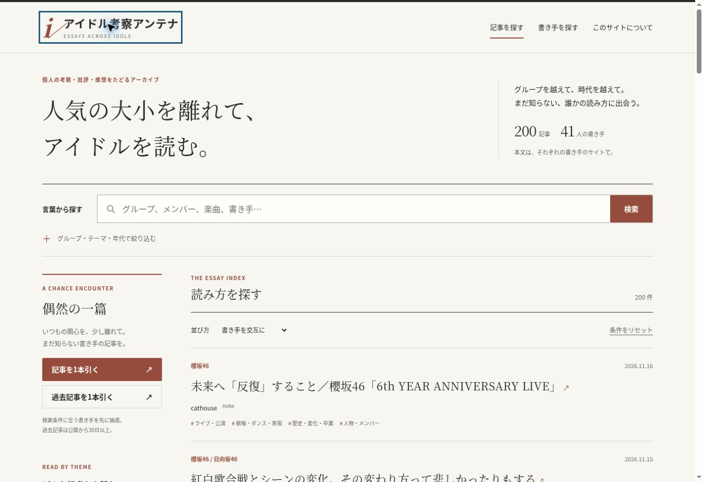

# デザイン刷新：公開確認記録

2026年11月18日（日本時間）。

- 公開URL：https://sakura-essays.github.io/idol-kosatsu-antenna/
- ソース反映コミット：e703fdfc87bf475568c3b2b004298f6d1330d866
- 生成物の保存コミット：460c3fe2cb85eadbd8da37cdc22e4fcb7d175e39
- Actions #39：https://github.com/sakura-essays/idol-kosatsu-antenna/actions/runs/44214294342
- publish job：134500134337、completed / success。
- Verify catalog and regressions、Build public metadata only、Persist cumulative metadata、Deploy Pages がすべてsuccess。
- push起動のためRSS収集は既存仕様通りskipped。収集・審査処理は変更していない。

## 公開画面の確認

ブラウザで公開トップを再読込して確認した。

|項目|実際に確認した結果|
|---|---|
|CSS|style.css?v=5ff2055c4d07。検証済みローカルCSSのSHA256先頭と一致|
|背景|rgb(248, 246, 241)|
|公開記事|200件|
|IVE検索|1件|
|書き手一覧|41人|
|サイト説明|本文・新しい共通ナビ・目次を表示|
|説明ページのJS|about.js?v=e8842ad464e3|
|公開トップへの復帰|ブランドリンクから正常に戻る|

公開後のorigin/mainに保存されたHTML・CSS・JS等の生成物は、ローカルで検証したビルドとバイト単位で一致することを照合した。config/、state/、検索コア、GA4、収集・審査、ワークフローには開始時点からの差分なし。姉妹サイトのローカル作業ツリーにも差分なし。

幅320/360/390/768/1280の計20画面はローカルの同一生成物で検証。公開サイトで端末20通りを再撮影したという意味ではない。

調査・設計・再修正・詳細テスト：[DESIGN_REFRESH_20261118.md](DESIGN_REFRESH_20261118.md)。
残る検証は、実スマートフォン、iOS/Safari、OS固有の文字拡大、支援技術。既知の公開ブロッカーなし。
