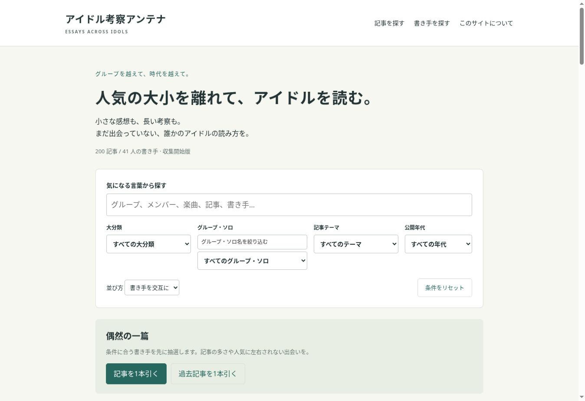
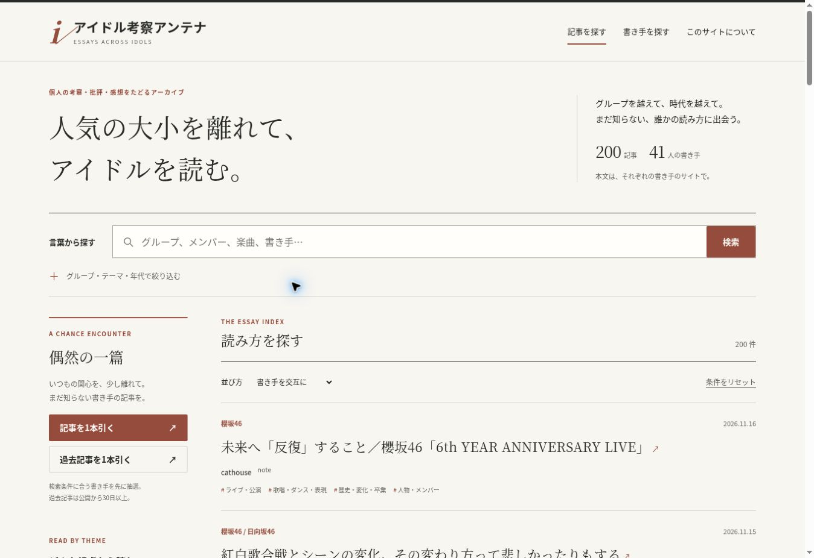
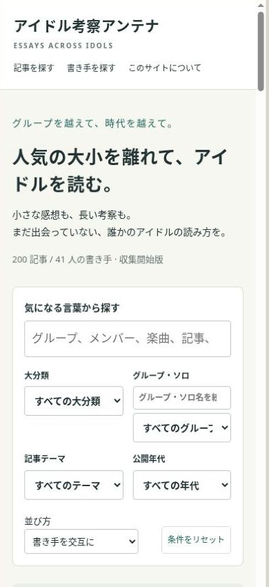
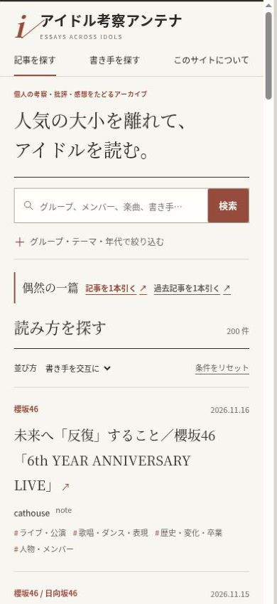

# アイドル考察アンテナ：デザイン全面刷新

2026年11月18日。改修対象は idol-kosatsu-antenna のみ。坂道考察アンテナは閲覧・比較のみ。
調査・改修時点の基準コミット：4bbfe8dc32ec19ba82e412e030fc87a6daef5c85。
基準データ：公開200記事・41人の書き手、ピックアップ0件。記事・書き手・分類・審査状況は変更していない。

## 選んだ方向性

**静かな批評誌。タイトルを読みながら、知らない視点を探せる索引。**

雑誌の表紙に見立てた大画像ではなく、文章の見出しそのものを視覚の中心にする。
生成りの紙面と墨色、赤茶の控えめなアクセントを使い、枠や背景色で区分する代わりに、罫線・文字の階層・余白で整理する。
姉妹サイトとは明朝の見出しと落ち着いた紙面を共有し、色、ロゴ、テーマ索引、抽選の配置は独立させた。

### 比較した3方向

各5点。設計上の主観評価であり、動作の保証やユーザーテストの点数ではない。

|方向|美しさ|読みやすさ|検索性|独自性|スマホ適性|運用容易性|判断|
|---|---:|---:|---:|---:|---:|---:|---|
|A 静かな文芸・批評誌|5|5|4|4|4|5|採用。長い日本語タイトルを中心にでき、画像を要しない|
|B 現代カルチャーメディア|5|4|3|4|4|3|画像・特集・記事の大小による編集が前提になりやすい|
|C デジタルアーカイブ|4|4|5|3|4|5|条件設定の画面になりやすく、訪問直後に文章へ惹かれる体験が弱い|

Aを一貫した視覚方針とし、必要な検索機能をその中へ配置した。3案の外観を混ぜ合わせる方法は採っていない。

### 配色・書体・一覧形式の比較

|検討対象|選んだ案|採らなかった案と理由|
|---|---|---|
|配色|生成り・墨・赤茶|白・黒・青は検索ツールの印象が強い。濃紺ベースはメディアとしての圧が強く、長い一覧に向きにくい|
|書体|見出し・記事タイトルは明朝、操作と補助情報はゴシック|全面ゴシックは文字の役割の差が小さい。全面明朝は操作ラベルや日付を拾いにくい|
|一覧|幅を確保した罫線付きリスト|多列カードは長い記事タイトルの高さがばらつく。画像中心の雑誌型は権利・運用・重さの面でも適さない|
|PCの構成|232pxの索引と可変幅の記事列|完全な1列は探し方の案内と記事が縦に離れる。3列は日本語タイトルを細くする|

## 参考サイト：観察と採用判断

11サイトをWeb検索で取得し、ブラウザでPC画面を確認した。書体・サイズは取得時のCSS値の一部であり、端末で実際に描画された字形の保証ではない。色数・比率は画像を除くUIの目視整理で、ピクセル集計ではない。
参考サイト全件についてスマートフォン画面を実機確認したという意味ではない。スマートフォンへの採否は本サイトの5幅検証で判断した。
noteのトップはメインフィードが読み込み待ちのため、その記事一覧の完成状態を見たものとして評価していない。note基盤の記事一覧は早川書房のページで別途確認した。

|サイト・確認URL|配色とアクセント|書体・サイズ・行間の観測例|余白・グリッド・記事の見せ方|ヘッダー・検索・分類|参考にした点／採らなかった点|
|---|---|---|---|---|---|
|[坂道考察アンテナ](https://sakura-essays.github.io/sakurazaka-kosatsu-antenna/)|#f8f7f3の紙面、墨色、くすんだ紫。無彩色が主体|H1：Yu Mincho系43px・500・行高66.65px。UIはNoto Sans JP系13px|大きめの余白、見出しと説明の2列、罫線で区切る記事一覧|記事・書き手・説明の3導線。グループ選択と詳細条件を分離|明朝と補助文字の階層、静かな紙面。今回のサイトはテーマ索引・抽選を記事と並置。専門サイト固有の坂道色タブは移植しない|
|[CINRA](https://www.cinra.net/)|白黒主体、オレンジ系を小さく使用|大見出し36px・700・行高50px、小見出し20px・700・28px、日付12px|大きい主記事と小さい記事群。画像とテキストの左右配分で強弱|分野と記事種別を分離。検索欄は独立|見出し／分類／日付の強弱。広告余白や大画像前提のファーストビューは採らない|
|[Real Sound](https://realsound.jp/)|白いヘッダー、濃紺の特集面、カテゴリのアクセント|Helvetica Neue/Roboto/日本語ゴシック。主見出し24px・700・33.6px、補助見出し16px・22.4px|取得時のナビ幅1240px。主記事＋縦に並ぶ副記事、分野別一覧|Music/Movie/Tech/Bookの明確な上位分類|大量の記事を分類で分ける考え方。ニュース・レビュー混在の高密度と複数の強い色面は模倣しない。一部画像が読み込み中であることも考慮|
|[note](https://note.com/)|白、グレー、濃い本文色。強調を限定|Helvetica Neue/Hiragino/Noto Sans系。サイドナビ16px・行高24px|トップの主フィードは読み込み待ち。読み込めたナビ・余白のみ評価|左ナビに分類や探索口を集約|操作語が短く親しみやすい点。ランキング・反応数の強調は本サイトの方針に合わない。未描画の記事列は評価しない|
|[It's Nice That](https://www.itsnicethat.com/)|白地、黒文字、ベージュの帯と紫の検索アクセント|BradfordのセリフとLabil系サンセリフ。ナビ等15px・行高21px。見出しは大きく、説明と強弱を付ける|主見出しと説明の非対称2列、下に画像グリッド|検索と大分類をまとまりとして扱う。固定ナビあり|セリフ／サンセリフの役割分担と小見出しの統一。固定フローティングナビ、大画像、過度に大きい英字組みは採らない|
|[MUUUUU.ORG](https://muuuuu.org/)|淡いグレー、黒、青緑の細い固定帯。UIは低彩度|YakuHanJP/LINE Seed JP系。主題35px・600・行高43.75px、ナビ14px。背景英字は300px|大きな代表例と小さなクレジット、細い罫線、分類の集積|カテゴリ検索を独立した入口にする|ラベル、タイトル、分類の役割分担。巨大な背景文字・グラデーション・追従広告は読書索引に不要。掲載作品の画像・ロゴは使用しない|
|[3:AM Magazine](https://www.3ammagazine.com/3am/)|白い本文、黒いナビ、赤黄の強いヘッダー画像|Cardo系本文18px・行高27px、Helvetica見出し30px・600・39px|幅1120pxのナビ。2列の長い文章導入とジャンル別のナビ|Reviews/Essays/Interviews等、読み物の種類が分かる|文章の存在感を担う見出しと著者の扱い。巨大ヘッダー画像、長い抜粋による一覧の肥大化は採らない|
|[Public Books](https://www.publicbooks.org/)|白・黒を基礎に黄色の帯。分類は水色・薄桃、紙色のサイド欄|Freeman見出し40px・行高48px、24px・31.92px。Libre Baskerville本文16px・22.4px|主記事481px、補助241px、サイド310pxの非対称。著者を明示|Reviews/Essays/Interviews/Sections等と検索欄|主情報と副情報を幅・文字で分ける点。人気ランキングと多数の色タグは採らない|
|[青空文庫](https://www.aozora.gr.jp/)|白、濃紺、青いリンク、淡い黄と水色の索引面|CSS上はTimes New Roman指定。日本語は環境依存。H1 24px・700、本文16px|作品／作家の50音索引、文字リンクを主役にする表組み|作家・作品など、探す軸を明示|書き手と記事の両方から探す設計。従来型の細かい表・密集したリンクをスマホへそのまま移さない|
|[Hayakawa Books & Magazines](https://www.hayakawabooks.com/)|note基盤の白とグレー。多色なのは書影・記事画像|日本語ゴシック。記事16px・700・行高24px、列幅284px。サイト名18px・700・27px|左に発信者、右に3列の記事一覧。書き手情報と記事列を分ける|新着／人気の短い切替とマガジン分類|発信者情報と記事の分離、親しみやすい操作語。画像依存・記事の反応数・人気順は採らない|
|[phaの日記](https://pha.hateblo.jp/)|紙のような背景、白い本文面、くすんだ青緑リンク、赤茶の日付|サイト名はセリフ32px、記事見出しはゴシック17.6px・700・22.88px、本文15.2px・25.84px|全体940px、本文600px。本文とサイド欄、日付による単位分け|右側のプロフィール・検索・日付の索引|文字主体の落ち着き、読みやすい本文幅。テクスチャ・影・大きな日付札は追加しない|

生のCSS測定値（引用テキストを含めない）は [design/reference-measurements.json](design/reference-measurements.json)。
補助候補のひつじ書房の一部URL等は取得できなかったため、閲覧した参考サイトに数えていない。

### スマートフォンへの判断

- 姉妹サイト：静かな見出しは継承し、上部の説明量と重複する収録数表示を減らす。
- CINRA／Real Sound／Public Books：PCの主副関係は参考にするが、PCの列を単純に縦積みしない。スマホは索引を省き、基本検索・抽選・記事を優先する。
- note／Hayakawa：短い操作語と単純な検索を参考にする。画像や人気指標に頼らない。
- It's Nice That／MUUUUU：見出し・補助文字の強弱を参考にするが、固定ナビや大きな演出を載せない。
- 青空文庫／3:AM／pha：文章と作家への入口を保ち、細かいリンクの密集や長い導入の積み上げを避ける。

## デザインシステム

### 色

|役割|値|設計意図|
|---|---|---|
|背景|#f8f6f1|純白より穏やかな紙面|
|操作欄などの面|#fffefa|背景とわずかに差を付け、枠を増やさない|
|本文|#292b29|黒に近い墨色|
|補助文字|#66685f|本文と役割を分けながら、背景とのコントラストを維持|
|罫線|#d9d6cc|面の境界を作る。文字の代替には使わない|
|アクセント|#964c3d|操作、分類、抽選に使用。グループ色を増やさない|
|フォーカス|#225e82|常時の赤茶と区別できる青。キーボード操作時に3pxの輪郭|

背景上のコントラスト比は本文13.21:1、補助5.24:1、アクセント5.72:1、フォーカス6.50:1。
背景と文字の明度差を計算した値で、全状態の網羅的なアクセシビリティ認証ではない。
背景・文字・罫線を大部分にし、赤茶は操作と目印だけに使う。

### 文字と余白

- 明朝：サイトのH1、一覧のH2、記事タイトル、書き手名。Noto Serif CJK JP、Yu Mincho、Hiragino Mincho等のローカル書体から選ぶ。
- ゴシック：検索、分類、ナビ、タグ、日付、説明本文。システム書体・Noto Sans CJK JP・Yu Gothic・Meiryoを指定。
- 英数字：収録数の大きい数字と独自の小さなマークのみGeorgiaを使う。メタ情報はゴシックで統一。
- 外部Webフォントを読み込まない。フォント取得待ちをなくす代わりに、OSによる字形・改行差は残る。
- 記事タイトルはPC22px・行高1.8。スマホ19px・行高1.85、最小幅では18px。行数制限・省略表示を付けず、長い題名を全文表示。
- スマホの分類・日付・タグは最終調整で11px、書き手名は12pxに引き上げた。主要検索の入力文字は16px。
- 内容最大幅1184px、PCの左右余白40px、索引232px、列間56px。狭くなると余白28/24/20/16pxへ段階的に変える。
- 記事ごとの白いカードや影を廃止。22〜25px程度の上下余白と細い罫線でまとまりを作る。

## 改修前と改修後

|項目|改修前|改修後|
|---|---|---|
|最初の画面|大きい導入、全条件の検索箱、抽選箱。記事は下方|検索は1行＋詳細の展開。PCは索引と記事を並べ、抽選も記事のそばに置く|
|記事の階層|日付・媒体→タイトル→書き手→多数の色面タグ|対象グループ／日付→明朝タイトル→書き手／媒体→控えめなテーマ|
|モバイル|PCの条件欄と説明を順に積む|重複する収録数とテーマ索引を省き、検索・抽選・記事を先に提示。詳細条件で全分類を操作可能|
|検索結果|選択内容は各入力欄へ戻って確認|選択中の条件を結果上に表示。条件ごとに解除できる|
|抽選|緑の説明箱内へ結果が挿入される|記事列の先頭に専用の結果欄。抽選後は結果へ移動し、閉じる操作で抽選ボタンへフォーカスを戻す|
|書き手|白い枠付きカード|罫線と書き手名中心の一覧。PC2列、スマホ1列。30人ずつ追加|
|サイト説明|単独の本文列|PCは目次と本文。スマホは目次を折りたたみ、本文を先に読める|
|保守|短いCSSにスタイルを集約|色・書体・寸法のCSS変数、読みやすく整形したCSS、全ページの共通パーツ・状態を統一|

390pxの同じ検証環境で、最初の記事タイトルの開始位置は**約1190pxから約600px**へ移動した。
これは画面上部からのCSS座標であり、読み込み時間や実機の使いやすさの測定値ではない。

### スクリーンショット

|PC 改修前|PC 改修後|
|---|---|
|||

|390px 改修前|390px 改修後|
|---|---|
|||

スマホ画像はPCブラウザ上の幅390pxの同一オリジンiframeを撮影したもの。実スマートフォンやデバイスエミュレーターの写真ではない。スクロールバーがあるため内容領域は375px。記事・人物・書き手はすべて既存の実データ。

## 変更ファイル

|編集元|変更内容|
|---|---|
|web/index.html|共通ヘッダー、導入、検索、詳細条件、テーマ索引、抽選、結果、ピックアップ、フッターの再構成|
|web/style.css|全画面共通の色・書体・余白・罫線・状態、レスポンシブ、印刷と動き抑制|
|web/app.js|記事／書き手の新しい表示、選択条件の解除、テーマ入口、抽選の結果欄、検索送信時と抽選時のフォーカス|
|web/about.html|共通ナビとフッター、既存本文を保った目次・本文のレイアウト|
|web/about.js|目次をPCで開き、小さい画面で閉じる初期状態と画面幅変更時の対応|
|scripts/build.py|既存H1の文言を保った2行の見せ方、説明ページのCSS・JSにも内容ハッシュを付けキャッシュを更新|
|docs/DESIGN_REFRESH_20261118.md / docs/design/*|調査・判断・検証・スクリーンショット|
|docs/WORK_PROGRESS.md / docs/NEXT_WORK.md|今回の進捗と次回の注意点|
|dist/*|編集元から生成。トップ、書き手一覧、説明、41人の個別ページ、CSS・JS。直接編集はしない|

既存の収集・承認・検索コア・GA4・Pages設定は変更していない。config/、state/、web/core.js、web/analytics.js、scripts/catalog.py、scripts/collect.py、.github/workflows/に改修差分なし。姉妹サイトの作業ツリーも変更なし。

## 検証結果

### 自動チェック

- python -m unittest discover -s tests -v：16件成功。
- node tests/search.cjs：検索・JST年代・表記揺れ・書き手先行抽選・交互表示・IVE/LIVE誤一致防止の回帰検証成功。3万件の検索／交互表示の検証も成功。
- node --check web/app.js、web/about.js：構文チェック成功。
- python scripts/build.py：公開200記事、41人、44HTMLページを正常生成。
- 全44ページのID重複なし、アプリの全DOM参照IDを保持。
- config、state、公開data.js、検索コア、GA4の内容は基準コミットと一致。
- Pythonの失敗保持テストが出す error 行は意図したテスト出力。本番RSSのエラーを示すものではない。今回、RSS収集はローカルで実行していない。

### ブラウザ操作

|項目|確認結果|
|---|---|
|基本検索|IVEで1件。LIVEを含む他グループ記事は混入しない|
|分類＋グループ|K-POP＋IVEで1件。グループ名の絞り込みも操作可能|
|テーマ|楽曲・歌詞・MVで69件。条件チップ解除で200件に戻る|
|年代|2010年代で23件。日付がその年代に収まる|
|並び替え|古い順の先頭2012.12.21。新しい順・ランダム・書き手交互を維持|
|追加表示|記事30→60、書き手30→41を確認|
|抽選|IVE指定中の結果がIVE。過去記事の抽選と空結果の表示経路も確認|
|空結果・リセット|0件の案内が表示され、リセットで200件に戻る|
|書き手|深山検索1人→個別ページ1記事の導線が正常|
|URL|既存のq/category/group/topic/era/author/sortを受け取り、選択状態を表示。書き手一覧の検索条件もURLに保持|
|ピックアップ|既存記事を使うローカル表示検証用fixtureで確認。本番の選定0件は変更せず、未選定の欄は非表示|
|GA4|テストモードでpage_view、view_search_results、filter_change、random_draw、article_impression、article_click、more_results、writer_search、writer_shuffleを確認。抽選結果のクリックはplacement=randomを保持。Googleへテスト送信していない|
|キーボード|検索欄→Tabで検索ボタンへ移動、青い輪郭を確認。検索送信・抽選後に結果へフォーカス、閉じると操作元へ復帰|

### 画面幅

トップ、書き手一覧、長いタイトルを含む書き手別ページ、説明ページをそれぞれ5幅で確認。計20通りで documentElement.scrollWidth と clientWidth が一致した。データは [design/viewport-checks.json](design/viewport-checks.json)。

|設定した幅|内容領域の幅|横はみ出し|主な構成|
|---|---:|---|---|
|320px|305px|なし|1列、簡略化した上部、抽選2ボタンは見出しの下|
|360px|345px|なし|1列、詳細条件の展開、長い題名を全文折り返し|
|390px|375px|なし|1列、検索→抽選→記事。タイトル19px|
|768px|753px|なし|記事は広い1列。テーマ索引と抽選を小さい2区画に整理|
|1280px|1265px|なし|左索引＋右記事、最大幅で余白を確保|

設定幅はiframeの幅。15pxの縦スクロールバーを含むため、内容領域は表の通り。画面幅・長いタイトル・詳細条件はブラウザで確認したが、実機の指操作、OS固有の文字拡大、Safari/iOS、全スクリーンリーダーの検証は未実施。

## 自己評価と再修正

|評価項目|点数|減点理由・確認した限界|
|---|---:|---|
|配色|13/15|役割は明確。赤茶と生成りは独自性より落ち着きを優先|
|タイポグラフィ|13/15|長い題名を全文表示。ローカル書体のためOS間の差が残る|
|レイアウトと余白|17/20|初期記事位置を改善。PCでも導入が先にある分、短い高さの画面では一覧を少しスクロールする|
|記事の見つけやすさ|13/15|検索・索引・抽選を明確化。本文検索や未登録語の辞書補完は既存仕様通り未対応|
|スマートフォンUI|13/15|5幅で確認。実機タッチ・OS固有文字拡大は未検証|
|独自性|7/10|文章主体の索引と抽選が特徴。視覚表現は奇抜さを抑え、姉妹サイトとの親和性を優先|
|一貫性|9/10|全44ページ共通。異なるOSでの微細な改行差は残る|
|合計|85/100|主観評価。自動・操作テストとは分離|

初回実装後、見出しの「む。」だけが次行へ落ちる問題を明示的な2行表示へ修正した。
スマホで記事が遅く出る問題は、上部の収録数重複とテーマ索引を省いて修正した。
320/360pxで抽選2ボタンの折り返しが不均衡になる問題は、見出しと操作を別段にした。
小さいタグ・日付は11pxに引き上げた。
説明ページの目次がスマホの本文を押し下げる問題は、展開式へ修正した。
フォーカス、記事の計測用DOM、既存URLの互換性を保っている。

## GitHub・公開確認

ソース変更はmainへ反映し、既存のpush起動のActionsで生成・Pages公開する。収集処理と公開設定は変更しない。
完了後のコミット、Actions、公開画面の確認結果は同じディレクトリの公開確認記録および最終報告に記録する。

## 残る事項

- 実スマートフォン・iOS/Safari・OSの文字拡大と支援技術での追加検証。
- ローカル書体を使うため、端末間で字形と折り返しが完全一致するわけではない。
- ピックアップは既存の未選定状態を維持。デザイン目的の架空記事・推薦文は登録していない。
- 検索範囲は既存の登録メタデータのまま。本文全文検索やデータの充実は今回の改修範囲外。
